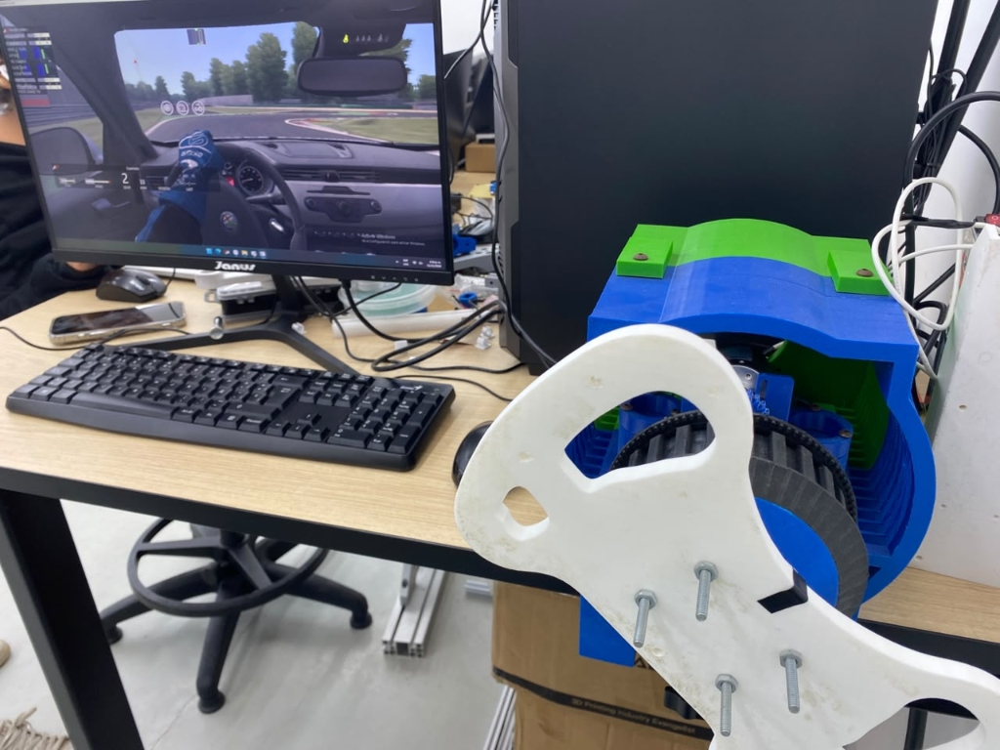
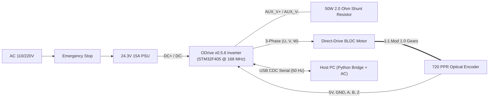
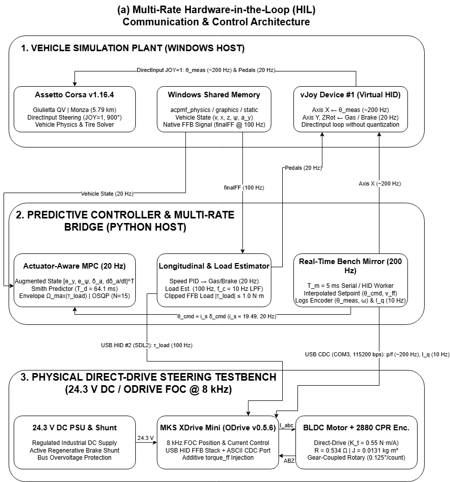

# Experimental Characterization of Load-Dependent Steering Capability and Its Integration into Predictive Path Tracking Control

Official open-source hardware, experimental datasets, predictive control formulation, and data analysis replication package for the research paper:  
**"Experimental Characterization of Load-Dependent Steering Capability and Its Integration into Predictive Path Tracking Control"**  
Submitted to *Vehicle System Dynamics* (Taylor & Francis), Q1.

**Authors:**  
- **Juan Camilo Díaz-López** ([jdiazlop@unal.edu.co](mailto:jdiazlop@unal.edu.co), ORCID: [0009-0008-1148-3120](http://orcid.org/0009-0008-1148-3120))  
- **Jesús Alberto Lastra-Robles** ([jalastrar@unal.edu.co](mailto:jalastrar@unal.edu.co), ORCID: [0009-0001-7982-2466](http://orcid.org/0009-0001-7982-2466))  
- **Francisco Javier Burgos-Flórez** ([fjburgosf@unal.edu.co](mailto:fjburgosf@unal.edu.co), ORCID: [0000-0002-5381-1398](http://orcid.org/0000-0002-5381-1398))  

*Escuela de Pregrado, Dirección Académica, Vicerrectoría de Sede, Universidad Nacional de Colombia, Sede La Paz, Cesar, Colombia.*  
*Institutional Funding: HERMES Research Project No. 69296.*

---

## Online Testbench Demonstration & Hardware Setup

<p align="center">
  
  <br>
  <em><b>Physical Testbench Overview:</b> Direct-drive steering actuator (ODrive v0.5.6 / MKS XDrive Mini, BLDC hub motor, 720 PPR optical quadrature encoder, and 24.3V DC power stage) integrated with Assetto Corsa in real-time Hardware-in-the-Loop.</em>
</p>

<p align="center">
  
  <br>
  <em><b>Live Video Demonstration:</b> Closed-loop steering tracking under resistive tire self-aligning torque load (50 Hz closed loop, 8 kHz internal FOC current control). Drop your recorded <code>bench_hil_demonstration.gif</code> into <code>hardware/media/</code> to stream inline on GitHub.</em>
</p>

> [!TIP]
> Complete instructions for converting recorded video runs (`.mp4`) into lightweight, online streaming GIFs via `ffmpeg` are provided in [`hardware/media/README.md`](hardware/media/README.md).

---

## 1. Abstract & Key Findings

In high-speed autonomous vehicle path tracking, conventional Model Predictive Control (MPC) formulations assume that steering actuators can sustain catalog-rated rotational speeds irrespective of resistive tire loads. However, tire self-aligning torques draw heavy motor quadrature currents, inducing internal ohmic drops that deplete DC bus voltage headroom and restrict back-electromotive force. As a result, achievable steering velocity contracts sharply under load, introducing unmodeled phase lag and compromising directional stability during aggressive reversals.

This repository provides everything required to reproduce the physical direct-drive steering testbench from scratch, along with the raw experimental logs, convex QP MPC formulations, and MATLAB data processing routines:

1. **Physical Testbench Identification:** Battery of 5 physical bench experiments on an ODrive direct-drive servomotor rig (8 kHz FOC), identifying handwheel and rotor inertia ($J = 0.01310\text{ kg}\cdot\text{m}^2$), Coulomb and viscous friction ($\tau_c = 0.26815\text{ N}\cdot\text{m}, b = 0.00279\text{ N}\cdot\text{m}\cdot\text{s/rad}$), loop transport delay ($\bar{T}_d = 64.06\text{ ms}$), static torque constant ($K_t = 0.550\text{ N}\cdot\text{m/A}$, $R^2 = 0.9995$), and small-signal bandwidth ($\omega_n = 23.80\text{ rad/s}, \zeta = 0.343$, $-3\text{ dB} = 5.38\text{ Hz}$).
2. **Physically Grounded Capacity Envelope:** A voltage-plateau power-law velocity boundary ($\gamma = 4.50, \tau_{\mathrm{stall}} = 2.45\text{ N}\cdot\text{m}$) enforcing smooth convergence to zero at the continuous thermal ceiling without premature throttling across moderate cornering loads ($R^2_{\mathrm{val}} = 0.9521$).
3. **Augmented Convex QP MPC:** State-space formulation $\bar{x} = [e_y, e_\psi, \delta_{\mathrm{act}}, \dot{\delta}_{\mathrm{act}}]^T$ with forward delay projection and previewed command-increment constraints, solved in real time via OSQP.
4. **Hardware-in-the-Loop Validation:** Multi-rate testing uniting Assetto Corsa v1.16.4 (14-DOF multibody physics, 100 Hz), Python supervisory bridge (20 Hz), and ODrive FOC (8 kHz):
   - **Monza Benchmark ($5.757\text{ km}$):** Statistically superior tracking and survival over kinematic MPC ($p = 0.0001$ Kruskal–Wallis; $p = 0.0001$ Mann–Whitney $U$, Cliff's $\delta = -0.96$).
   - **Zero-Shot Cross-Track Transfer (Magione, $2.455\text{ km}$):** 100% completion across Conservative, Nominal, and Fast profiles without controller retuning.
   - **Real-Time Execution:** Mean solve time is $0.65\text{ ms}$, P95 is $1.02\text{ ms}$, and WCET is $11.62\text{ ms}$ across $N = 53,037$ continuous cycles (76.8% idle margin inside the 50 ms window).

---

## 2. Complete Hardware Replication Package

All physical components, electrical schematics, and mechanical CAD models are fully documented to enable 100% reproduction:

```text
hardware/
├── BOM.md                  # Comprehensive Bill of Materials, part specs, suppliers, and costs
├── SCHEMATICS.md           # Electrical schematics, power distribution, and pinout diagrams
├── cad/
│   ├── README.md           # 3D printing guidelines, mechanical specs, and assembly instructions
│   └── stl/                # Stereolithography 3D-printable mesh files (.stl)
└── media/
    ├── README.md           # Media archive guidelines and video conversion pipeline
    ├── bench_overview_hil.jpg # Physical direct-drive testbench setup
    └── bench_hil_demonstration.gif # Real-time HIL demonstration preview
```

### 2.1 Bill of Materials Summary
Detailed specifications, ratings, and approximate costs are listed in [`hardware/BOM.md`](hardware/BOM.md):
- **Actuator:** 6.5-inch 36V/350W BLDC Hub Motor (30 poles, 15 pole pairs, direct drive).
- **Inverter:** MKS XDrive Mini / ODrive v0.5.6 (STM32F405 MCU @ 168 MHz, DRV8301 gate driver, 8 kHz FOC).
- **Power Supply:** Industrial switching DC PSU ($24.3\text{ V}$, $15\text{ A}$, $365\text{ W}$).
- **Dynamic Brake:** Aluminum wirewound power resistor ($50\text{ W}$, $2.0\,\Omega$) on `AUX` rail.
- **Position Sensor:** Optical incremental quadrature encoder (720 PPR / 2,880 CPR, 5V DC).
- **Safety Interlock:** Push-lock twist-reset mushroom emergency stop button.

### 2.2 Electrical Schematics & Interconnections
Complete circuit diagrams, wire gauges, grounding, and pinouts are detailed in [`hardware/SCHEMATICS.md`](hardware/SCHEMATICS.md):



### 2.3 3D CAD Models & Mechanical Parts
All CAD parts, printing orientations, and infill parameters are documented in [`hardware/cad/README.md`](hardware/cad/README.md):
1. **Steering Wheel Rim:** Ergonomic 270 mm D-cut wheel (PETG, 50% Gyroid infill, 5 perimeters).
2. **Motor Hub Adapter:** 70 mm PCD 4-bolt adapter for rigid shaft torque transmission.
3. **Chassis & Motor Mount Bracket:** Heavy-duty L-bracket for 2020/2040 aluminum extrusion workbench.
4. **Encoder Mount Bracket & 40T Gears:** Mod 1.0 anti-backlash spur gear pair (1:1 ratio).
5. **Emergency Stop Desktop Enclosure.**

---

## 3. Software Architecture & Multi-Rate Information Flow

The Hardware-in-the-Loop system runs across three asynchronous timing domains:

<p align="center">
  
  <br>
  <em><b>Figure 1:</b> Multi-rate Hardware-in-the-Loop communication architecture and signal flow across simulation, predictive supervisor, and actuator tiers.</em>
</p>

### Mathematical Formulation Summary
- **Augmented State:** $\bar{x} = [e_y, e_\psi, \delta_{\mathrm{act}}, \dot{\delta}_{\mathrm{act}}]^T$
- **Input:** $u = \delta_{\mathrm{cmd}}$, with slew rate increments $\Delta u_k = u_k - u_{k-1}$
- **Transport Delay Compensation:** Forward state projection over $\bar{T}_d = 64.06\text{ ms}$ ($k_{\mathrm{proj}} = 2$ steps)
- **Dynamic Rate Constraint:**
  $$|\Delta u_k| \le T_s \cdot \dot{\delta}_{\max}(\tau_a), \quad \dot{\delta}_{\max}(\tau_a) = \dot{\delta}_{\mathrm{free}} \left(1 - \left[\frac{\min(|\tau_a|, \tau_{\mathrm{stall}})}{\tau_{\mathrm{stall}}}\right]^\gamma\right)^{1/\gamma}$$
  where $\dot{\delta}_{\mathrm{free}} = 10.47\text{ rad/s}$ ($600^\circ/\text{s}$), $\tau_{\mathrm{stall}} = 2.45\text{ N}\cdot\text{m}$, $\gamma = 4.50$.
- **Convex QP Objective:**
  $$\min_{\Delta \mathbf{u}, \boldsymbol{\varepsilon}} \sum_{k=1}^{N_p} \|\bar{x}_{k|t} - \bar{x}_{\mathrm{ref}}\|_{\mathbf{Q}}^2 + \sum_{k=0}^{N_c-1} \|\Delta u_{k|t}\|_{\mathbf{R}}^2 + \rho_\varepsilon \|\boldsymbol{\varepsilon}\|_2^2$$

---

## 4. Software Dependencies & Exact Toolchain

| Software / Tool | Exact Version | Role / Purpose |
| :--- | :---: | :--- |
| **Operating System** | Windows 10 / 11 64-bit | Real-time simulation host and multi-rate scheduler |
| **MATLAB** | R2023b (or newer) | Data analysis, parameter identification, and statistical hypothesis tests |
| **Optimization Toolbox** | v9.6+ | Quadratic Programming solvers (`quadprog`, OSQP MATLAB) |
| **Statistics & ML Toolbox** | v12.6+ | Non-parametric statistical tests (`kruskalwallis`, `ranksum`, Cliff's $\delta$) |
| **Python** | 3.10.x / 3.11.x | Real-time supervisory bridge and HIL orchestrator |
| **OSQP (Python)** | v0.6.3 | Operator Splitting QP solver for real-time MPC |
| **pyvjoy** | v1.0.1 | DirectInput virtual joystick communication bridge |
| **pyserial** | v3.5 | High-speed USB CDC serial ASCII driver for ODrive |
| **Assetto Corsa** | v1.16.4 | 14-DOF multibody vehicle dynamics physics simulation engine |
| **vJoy Virtual Driver** | v2.1.9 | Kernel-level DirectInput driver for steering injection |
| **ODrive Firmware** | v0.5.6 | Embedded Field-Oriented Control (FOC) firmware on STM32F405 |

---

## 5. Experimental Data Analysis & Reproduction

All core data processing, analytical modeling, and statistical benchmarks are implemented in clean, standalone MATLAB routines under [`scripts/matlab/`](scripts/matlab/README.md).

### Step 1: Physical Actuator Parameter Identification (Phase 1)
Processes 135 raw CSV logs from the 5 physical bench tests to extract inertia, friction, transport delay, torque constant, and frequency response:
```matlab
% In MATLAB:
run('scripts/matlab/process_phase1_bench_data.m');
```
*Outputs:* `results/phase1_actuator_params.mat` and identified figures `Fig2` to `Fig4`.

### Step 2: Capacity Envelope Analytical Fit (Phase 2)
Fits the voltage-plateau power-law capability boundary against experimental load-speed saturation data:
```matlab
run('scripts/matlab/process_phase2_capacity_envelope.m');
```
*Outputs:* `results/phase2_envelope_model.mat` ($\gamma = 4.50$, $\tau_{\mathrm{stall}} = 2.45\text{ N}\cdot\text{m}$, $R^2_{\mathrm{val}} = 0.9521$).

### Step 3: Predictive Controller Formulation & SIL Ablation (Phase 3)
Executes the convex QP MPC simulation-in-the-loop comparison across Kinematic, Rate-Saturated, and Proposed Capacity-Aware formulations:
```matlab
run('scripts/matlab/run_phase3_mpc_formulation_and_sil.m');
```
*Outputs:* `results/phase3_mpc_sil_results.mat` (generates tracking metrics reported in Table 3).

### Step 4: Hardware-in-the-Loop Validation & Telemetry Ingestion (Phase 4)
Processes the full-lap telemetry datasets recorded on the Monza and Magione circuits:
```matlab
run('scripts/matlab/process_phase4_hil_validation.m');
```
*Outputs:* `results/phase4_hil_validation_results.mat` (lateral tracking RMSE, MAE, mechanical steering energy $W_\delta$).

### Step 5: Statistical Hypothesis Testing & Common Window Analysis
Evaluates the pre-crash evaluation window ($s \in [0, 480]\text{ m}$) and runs Kruskal–Wallis, Mann–Whitney $U$, and Cliff's $\delta$ effect size calculations:
```matlab
run('scripts/matlab/analyze_hil_precrash_and_stats.m');
```
*Outputs:* `results/hil_precrash_stats.mat` ($p = 0.0001$, Cliff's $\delta = -0.96$).

---

## 6. Raw Datasets Structure

Experimental datasets are organized under `data/raw/`:

```text
data/raw/
├── bench_phase1/             # 135 raw CSV logs from physical bench identification
│   ├── test1_inertia/        # Step-torque acceleration runs (rotor + handwheel inertia)
│   ├── test2_delay/          # Command-to-response pulse transport delay logs
│   ├── test3_rate_sat/       # Unloaded maximum rotational velocity steps
│   ├── test4_frequency/      # Multi-frequency logarithmic chirp sweeps (0.1 to 10 Hz)
│   └── test5_torque_speed/   # Velocity saturation under active resistive counter-torques
└── hil_phase4/               # Full-lap closed-loop HIL telemetry runs
    ├── monza_kinematic/      # Autodromo Nazionale di Monza (Kinematic baseline runs)
    ├── monza_rate_lim/       # Monza (Constant rate-limited baseline runs)
    ├── monza_proposed/       # Monza (Proposed capacity-aware MPC runs)
    └── magione_transfer/     # Autodromo dell'Umbria (Zero-shot transfer runs)
```

---

## 7. Citation

If you use this testbench design, experimental datasets, predictive control formulation, or MATLAB analysis code in your research, please cite:

```bibtex
@article{DiazLopez2026_VSD,
  author    = {D{\'i}az-L{\'o}pez, Juan Camilo and Lastra-Robles, Jes{\'u}s Alberto and Burgos-Fl{\'o}rez, Francisco Javier},
  title     = {Experimental Characterization of Load-Dependent Steering Capability and Its Integration into Predictive Path Tracking Control},
  journal   = {Vehicle System Dynamics},
  year      = {2026},
  volume    = {64},
  number    = {X},
  pages     = {1--25},
  publisher = {Taylor \& Francis},
  doi       = {10.1080/00423114.XXXXXX}
}
```

---

## 8. License

- **Software & Hardware Codebase:** Licensed under the [MIT License](LICENSE).
- **Experimental Datasets & Documentation:** Licensed under [Creative Commons Attribution 4.0 International (CC-BY-4.0)](https://creativecommons.org/licenses/by/4.0/).
