# Electrical Schematics & Hardware Interconnection Guide

This document describes the complete electrical schematic, component pinouts, power distribution, and signal interconnection for reproducing the physical direct-drive steering testbench.

---

## 1. System Interconnection Architecture

The testbench comprises five primary electrical subsystems:
1. **AC Mains & Power Distribution Unit (PSU)** with integrated emergency cutoff.
2. **Dynamic Braking Subsystem** to absorb regenerative back-EMF energy.
3. **MKS XDrive Mini / ODrive v0.5.6 Inverter** running Field-Oriented Control (FOC) at 8 kHz.
4. **Permanent Magnet Brushless DC (BLDC) Motor & Optical Quadrature Encoder**.
5. **Host Workstation** running the real-time Python multi-rate bridge and Assetto Corsa simulation.

```mermaid
graph TD
    subgraph AC_Mains_and_Power ["AC Mains & Power Supply"]
        Mains["AC 110V/220V Input"] --> E_STOP["Emergency Stop Pushbutton (NC)"]
        E_STOP --> PSU["24.3V 15A Industrial Switching PSU"]
        PSU -->|"DC+ (24.3V, 14 AWG)"| ODrive_PWR_POS["ODrive DC+ Terminal"]
        PSU -->|"DC- (GND, 14 AWG)"| ODrive_PWR_NEG["ODrive DC- Terminal"]
    end

    subgraph Brake_Energy_Dissipation ["Regenerative Energy Shunt"]
        ODrive_AUX1["AUX_V+"] --- BRK_RES["50W 2.0 Ohm Aluminum Braking Resistor"]
        BRK_RES --- ODrive_AUX2["AUX_V- (Low-side MOSFET)"]
    end

    subgraph ODrive_Controller ["ODrive v0.5.6 / MKS XDrive Mini (STM32F405)"]
        ODrive_PWR_POS
        ODrive_PWR_NEG
        ODrive_AUX1
        ODrive_AUX2
        MCU["STM32F405 @ 168 MHz (8 kHz FOC Loop)"]
        DRV["DRV8301 3-Phase Gate Driver"]
        ENC_PORT["Axis 0 Encoder Header (5V, GND, A, B, Z)"]
        PHASE_OUT["Phase Terminals (U, V, W)"]
        USB_PORT["USB Type-C / Micro-USB Port"]
    end

    subgraph Physical_Actuator ["Physical Steering Assembly"]
        PHASE_OUT -->|"Phase U (Blue, 16 AWG)"| MOT_U["BLDC Motor Phase U"]
        PHASE_OUT -->|"Phase V (Yellow, 16 AWG)"| MOT_V["BLDC Motor Phase V"]
        PHASE_OUT -->|"Phase W (Green, 16 AWG)"| MOT_W["BLDC Motor Phase W"]
        
        ROTOR["Motor Rotor Shaft"] ===|"1:1 Mod 1.0 Gear Pair"| ENC_SHAFT["Encoder Shaft"]
        
        ENC_SHAFT --> ENC_BODY["720 PPR Optical Incremental Encoder"]
        ENC_BODY -->|"5V DC (Red)"| ENC_PORT
        ENC_BODY -->|"GND (Black)"| ENC_PORT
        ENC_BODY -->|"Channel A (White/Green)"| ENC_PORT
        ENC_BODY -->|"Channel B (Yellow/White)"| ENC_PORT
        ENC_BODY -->|"Channel Z / Index (Orange)"| ENC_PORT
    end

    subgraph Host_Workstation ["Host Workstation (Windows 10/11 x64)"]
        USB_ISOLATOR["USB Optical Isolator / Hub"]
        USB_PORT <-->|"USB 2.0 High-Speed Serial CDC (COM3)"| USB_ISOLATOR
        USB_ISOLATOR <-->|"Host USB Controller"| PC["Python Real-Time Bridge (20 Hz)"]
        PC <-->|"Shared Memory (acpmf_physics)"| SIM["Assetto Corsa v1.16.4 (100 Hz Physics)"]
        PC -->|"vJoy DirectInput Driver"| SIM
    end
```



---

## 2. Wiring & Pinout Tables

### 2.1 DC Power & Regenerative Brake Connections

| Terminal / Pin | Wire Gauge | Destination | Description |
| :--- | :---: | :--- | :--- |
| **AC L / N / PE** | 16–18 AWG | 110V/220V AC Outlet | Mains power feed through Emergency Stop switch |
| **PSU V+ (+24.3V)** | 14 AWG | ODrive `DC+` | Main positive DC bus input |
| **PSU V- (GND)** | 14 AWG | ODrive `DC-` | Main ground reference (star-grounded) |
| **ODrive AUX V+** | 18 AWG | Brake Resistor Pin 1 | Positive brake clamp rail |
| **ODrive AUX V-** | 18 AWG | Brake Resistor Pin 2 | Low-side chopper MOSFET switched shunt return |

> [!CAUTION]
> The aluminum power resistor ($50\text{ W},\,2.0\,\Omega$) dissipates heat during violent counter-steering reversals. Mount it directly to an aluminum heat sink or the metal frame. **Do not mount against PLA or 3D-printed plastic without thermal standoff**.

---

### 2.2 Motor Phase Output (Axis 0)

| ODrive Terminal | Wire Color | Motor Phase | Function |
| :---: | :---: | :---: | :--- |
| **M0_U** | Blue | Phase U (A) | High-current inverter half-bridge output U |
| **M0_V** | Yellow | Phase V (B) | High-current inverter half-bridge output V |
| **M0_W** | Green | Phase W (C) | High-current inverter half-bridge output W |

- **Phase Resistance ($R_s$):** $0.534\,\Omega$ phase-to-phase.
- **Phase Inductance ($L_s$):** $0.465\,\text{mH}$.
- **Torque Constant ($K_t$):** $0.550\text{ N}\cdot\text{m/A}$.

---

### 2.3 Optical Encoder Header (Axis 0)

The optical encoder provides position feedback with 720 pulses per revolution (2,880 counts per revolution after $4\times$ quadrature decoding in the STM32 timer hardware).

| ODrive Header Pin | Encoder Signal | Wire Color | Function |
| :---: | :---: | :---: | :--- |
| **5V** | $V_{cc}$ | Red | Regulated +5.0V DC logic supply (ODrive onboard LDO) |
| **GND** | $GND$ | Black | Logic ground reference |
| **M0_A** | Channel A | White | Incremental quadrature phase A ($90^\circ$ lead/lag) |
| **M0_B** | Channel B | Green | Incremental quadrature phase B |
| **M0_Z** | Index Z | Orange / Yellow | Single index pulse per revolution (homing/reference) |

> [!NOTE]
> Run the encoder cable as a twisted/shielded bundle separate from the motor phase wires. High PWM $dv/dt$ from the inverter bridge can induce electrical noise in unshielded encoder lines.

---

### 2.4 Host Workstation Communication

| Interface | Protocol | Port / Device | Update Rate | Baud / Clock |
| :--- | :--- | :--- | :---: | :--- |
| **ODrive Telemetry** | ASCII / Native CDC | `COM3` (USB-VCP) | 50 Hz | 115,200 bps / 12 Mbps USB FS |
| **Steering Input** | DirectInput API | vJoy Device 1 | 20 Hz | 16-bit virtual axis (`0` to `32767`) |
| **Vehicle Telemetry** | Windows Shared Memory | `Local\acpmf_physics` | 20 Hz (read from 100 Hz) | Memory-mapped buffer |

---

## 3. Schematic Diagram (ASCII Representation)

```text
========================================================================================
                          PHYSICAL ELECTRICAL SCHEMATIC
========================================================================================

  [AC MAINS 110/220V]
        |
      [ E-STOP ] (Normally Closed Mushroom Switch)
        |
     +-----+---------------------------------------+
     | L   N   PE                                  |
     |        SWITCHING POWER SUPPLY (24.3V 15A)   |
     | +V (+24.3V)                         -V (GND)|
     +--+------------------------------------+-----+
        | (14 AWG Red)                       | (14 AWG Black)
        |                                    |
     +--v------------------------------------v-----+
     | DC+                                  DC-    |
     |                                             |
     | AUX_V+ -------[ 50W 2.0 Ohm RESISTOR ]------| (AUX_V- Chopper)
     |                                             |
     |              MKS XDrive Mini / ODrive       |
     |                 STM32F405 @ 168 MHz         |
     |                                             |
     |   M0_U        M0_V        M0_W              |
     +----+-----------+-----------+----------------+
          |           |           | (16 AWG Silicon Wires)
          v           v           v
       [ Phase U   Phase V   Phase W ]
       [                             ]
       [   DIRECT-DRIVE BLDC MOTOR   ]=====[ 1:1 GEARS ]=====[ 720 PPR ENCODER ]
       [    30 POLES, 2.45 Nm MAX    ]                           |  |  |  |  |
       +-----------------------------+                           |  |  |  |  |
                                                                 |  |  |  |  |
                      ODrive Axis 0 Encoder Header               |  |  |  |  |
                      [ +5V | GND | M0_A | M0_B | M0_Z ]         |  |  |  |  |
                         ^     ^     ^      ^      ^             |  |  |  |  |
                         |     |     |      |      |             |  |  |  |  |
                         +-----+-----+------+------+-------------+--+--+--+--+
                                (Shielded Ribbon Cable)

     +-----------------------------+
     | ODrive Micro-USB / Type-C   |
     +--------------+--------------+
                    | (Shielded USB Cable)
                    v
          [ USB OPTICAL ISOLATOR ]
                    |
                    v
          [ HOST WORKSTATION PC ]
             - Python 3.10 Bridge (COM3)
             - vJoy DirectInput Device
             - Assetto Corsa Shared Memory
========================================================================================
```

---

## 4. Safety Interlocks & Startup Sequence

1. **Pre-Power Inspection:**
   - Verify that the brake resistor is firmly attached to `AUX_V+` and `AUX_V-`.
   - Ensure the handwheel has free rotation without pinching cables.
   - Verify no conductive debris is resting on the inverter PCB.

2. **Power-On:**
   - Pull out the Emergency Stop pushbutton to energize the 24.3V DC power supply.
   - Confirm the green status LED on the ODrive lights up steady.

3. **Encoder Calibration Routine:**
   - On the host PC, launch the Python hardware bridge:
     ```bash
     python scripts/bench/odrive_ascii_interface.py --calibrate
     ```
   - The motor performs an automated phase-resistance, phase-inductance, and encoder index offset sweep ($1.5\text{ s}$).
   - Once calibrated, the motor enters closed-loop torque control (`AXIS_STATE_CLOSED_LOOP_CONTROL`).

4. **Emergency Shutdown:**
   - In the event of an abnormal oscillation, hitting the physical **Emergency Stop button** disconnects DC bus power instantaneously.
   - The software supervisory bridge catches connection loss within $50\text{ ms}$ and commands zero steering angle to Assetto Corsa.
